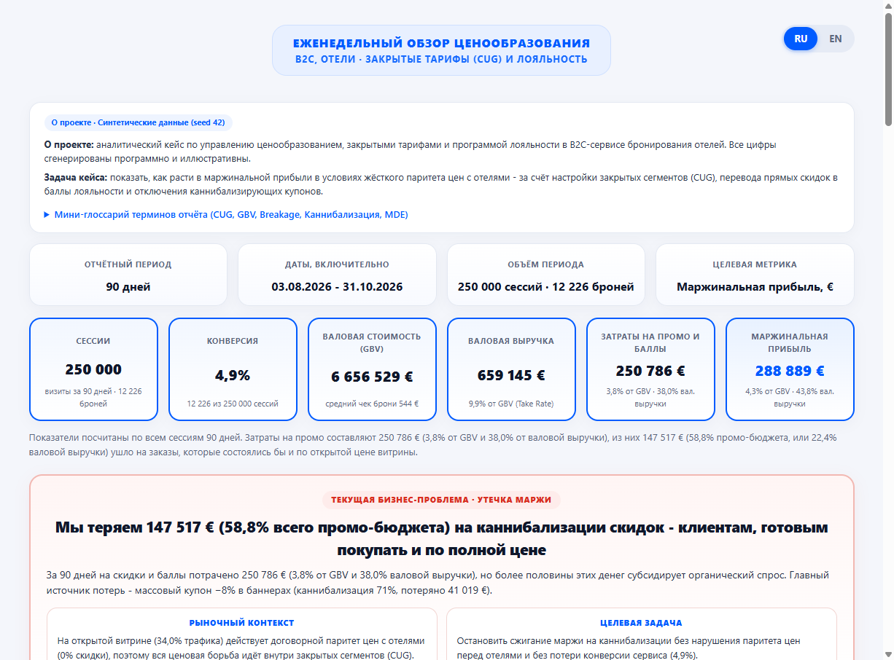

# B2C Hotel OTA Pricing Engine - Closed-User-Group (CUG), Loyalty & Promo Optimization

> **Note:** Synthetic data (seed = 42), all figures are illustrative and contain no proprietary OTA data.

[**Русская версия → README.ru.md**](README.ru.md) · [**Open Interactive Pricing Report & Sensitivity Simulator (RU / EN) →**](https://kochetova-daryaa.github.io/ota-cug-loyalty-pricing/)

An end-to-end pricing, Closed-User-Group (CUG), and loyalty optimization project for a B2C hotel Online Travel Agency (OTA). The Python package is named `keystone` - referring to the arch keystone that balances two opposing commercial forces in hotel distribution: maintaining public rate alignment with hotel partners on the open storefront while competing on price and conversion inside closed user groups.

In hotel distribution, commercial agreements with hotel partners and metasearch ranking rules require maintaining price parity on public storefronts (`public_parity`). As a result, real price competition, conversion optimization, and margin management happen inside **Closed-User-Group (CUG) segments**: logged-in web (`member_web`), mobile app (`app_only`), abandoned-checkout triggers (`cart_recovery`), and promotional coupons (`blanket_promo`).

This repository diagnoses **promo cannibalization** across 250,000 synthetic sessions (90 days: 2026-08-03 to 2026-10-31) and delivers a weekly pricing package backed by Python, SQL window functions, a 50/50 A/B test with an interactive accrual-sensitivity simulator, an Excel model with live formulas, Power BI / Tableau measures, and a bilingual (RU / EN) executive report.

[](https://kochetova-daryaa.github.io/ota-cug-loyalty-pricing/)

---

## 1. Executive Summary & Full P&L Bridge (90-Day Baseline)

- **Baseline (90 days, 250,000 sessions, 12,226 bookings, 4.9% conversion):**
  - **Gross Booking Value (GBV):** **€6,656,529** (€544 average booking value)
  - **Gross Revenue (retained commission after cancellations):** **€659,145** (**9.9% of GBV Take Rate**). *Why 9.9% at a 12% markup?* A 12% markup over hotel net rate equals `12 / 112 = 10.71%` of gross sell price (GBV) before cancellations; after ~10% cancellations (where 25% of the fee is retained), realized Gross Revenue is 9.9% of total GBV.
  - **Promo & Loyalty Spend:** **€250,786** (3.8% of GBV · 38.0% of Gross Revenue)
  - **Promo Cannibalization Loss:** **€147,501** (**58.8% of all promo spend** went to customers who would have booked at the public parity price anyway)
  - **Payment Processing (1.4% of retained GBV) & Traffic Cost:** **€86,129** payment processing + **€33,342** session acquisition cost = **€119,470**
  - **Contribution Margin (target KPI):** **€288,889** (4.3% of GBV · 43.8% of Gross Revenue), reconciled as:
    `€659,145 (Gross Revenue) − €250,786 (Promo & Loyalty) − €86,129 (Payment 1.4%) − €33,342 (Traffic) = €288,889`
- **Approved Weekly Decision Package:**
  - **Contribution Margin impact:** **+€72,640 (+25.1% vs. baseline)**, lifting margin from 4.3% to 5.4% of GBV (€288,889 → €361,529)
  - **Promo Spend reduction:** **−€70,583 (−28.1% vs. current promo budget)**
  - **Conversion impact:** **+0.0 pp (+0.3% relative)** while maintaining **100% public storefront parity** (120 of 120 hotel shelf rules compliant)

### Three Levers Delivering 100% of the Impact

| Lever | Share of Impact | Δ Contribution Margin | Δ Promo Spend | Core Pricing Change |
|---|---:|---:|---:|---|
| **1. Retire Low-Efficiency Banner Coupon** (`blanket_promo`) | **52.9%** | +€38,402 (base €3,016 → €41,419) | −€41,661 (−71.4%) | Close the −8.0% public coupon (71% cannibalization) and gate into 5.0% welcome loyalty points (2.4% accrued cost) |
| **2. Cash-to-Points Shift** (`member_web` + `cart_recovery`) | **28.6%** | +€20,792 | −€21,999 | Roll 9.0% points (4.3% accrued cost) out to the remaining 50% of logged-in web (+€11,457) and set a €180 minimum basket on cart recovery with 7.5% points (+€9,335) |
| **3. Lead-Time Tiering in Mobile App** (`app_only`) | **18.5%** | +€13,445 (+19.4%) | −€6,923 (−8.3%) | Replace flat −5.0% app discount with −3.0% on inelastic 0–3d stays (69% cannibalization) and −6.0% on elastic 8+d stays (39% cannibalization, +0.3 pp conversion) |

---

## 2. Classic 50/50 A/B Test & Accrual Model (`member_web`: −6% Cash vs. 9% Loyalty Points)

- **Setup:** 60,337 sessions on logged-in web split 50/50 across all 90 days:
  - **Group A (Control):** −6.0% instant cash discount (29,904 sessions, 1,362 bookings, **€19,313** contribution margin)
  - **Group B (Treatment):** 9.0% loyalty points cashback (30,433 sessions, 1,484 bookings, **€33,880** expected contribution margin at 4.3% of GBV accrued cost)
- **What is experimentally measured vs. modeled:**
  - **Experimentally measured (Conversion & Cancellations):** Conversion was 4.6% in Group A vs. 4.9% in Group B (+0.3 pp, +7.1% vs. Control, two-proportion z-test `p = 0.062`). This does not prove superiority of conversion, but confirms **no conversion degradation beyond the 2.5% non-inferiority guardrail** (and sits inside the 80%-power MDE = 0.5 pp). Cancellation rate was unchanged (8.8% vs. 8.9%).
  - **Modeled via points accrual (Contribution Margin):** Because loyalty points carry a 12-month expiry window, realized redemption is not observable inside a 90-day test. Unit promo cost in Group B is booked via an accrual model (`4.32%` of GBV vs. `6.00%` cash), yielding €0.646 in Group A vs. **€1.113** in Group B (**+€0.467 per session, +72.4% vs. Control**, Welch t-test 95% CI €0.381 … €0.553, `p < 0.001`). Both the HTML report and the Excel workbook include interactive sensitivity controls for breakage and repeat-ad credit.
- **Reconciliation with the Decision Matrix:**
  - During the 90-day observation window, `member_web` was running the 50/50 split (`€19,313` in Group A + `€33,880` in Group B = `€53,193` baseline margin; average promo cost 5.2% of GBV).
  - Rolling Group B out to the remaining 50% of traffic (Group A) uses a **conservative 0.0% conversion change** (rather than booking the noisy +7.1% point estimate, since `p = 0.062 > 0.05`), yielding **+€11,457** in incremental contribution margin and **−€11,457** in promo spend.

---

## 3. Model Assumptions & How to Measure in Production

Because the dataset is synthetic (`keystone/generate.py`), latent customer states are explicit in the simulation. In a production OTA environment, these parameters are estimated and monitored as follows:

1. **Promo Cannibalization (`cannibalized` flag in generator vs. Production Holdout):**
   - *In the synthetic generator:* each session has a baseline organic conversion probability (`cvr_organic`) and an incremental promo uplift (`cvr_uplift`); bookings that would have occurred under `cvr_organic` alone are flagged as cannibalized. In `app_only`, short-lead stays (0–3 days) have high organic intent (69% cannibalization), whereas 8+ day stays are comparison-shopped (39% cannibalization, higher elasticity), which is why shifting discount depth from 0–3d to 8+d raises conversion even at a lower average discount (4.4% vs. 5.0%).
   - *In production:* an individual customer's counterfactual ("would have bought anyway") is unobservable directly and is measured via a **persistent 5–10% Holdout group** (eligible users who are not shown the coupon/banner). The ratio `CVR_holdout / CVR_promo` gives the empirical cannibalization share for each segment and lead-time bucket.
2. **Loyalty Points Breakage (36%) and Repeat Ad-Spend Saving (25%):**
   - *Accrued Points Cost Formula (`keystone/economics.py`):*
     ```text
     c_eff = r_nominal * (1 - breakage) * (1 - ad_saving)
           = 0.09 * (1 - 0.36) * (1 - 0.25) = 0.0432 (4.32% of GBV)
     ```
   - *Calibration & accounting note:* Both 36% breakage and 25% repeat acquisition saving are **model assumptions** calibrated on internal cohorts (12-month points-expiration cohorts and direct-vs-paid repeat booking attribution). If finance policy does not credit future CAC savings against loyalty liability (`ad_saving = 0%`), strict liability accrual for 9.0% points is `0.09 * (1 - 0.36) = 5.76%` of GBV, which still beats the 6.0% cash discount (with a break-even breakage threshold of 33.3% at zero ad credit, or 11.1% with 25% ad credit, on promo cost rate alone; on contribution margin per session, which also counts Group B's extra bookings, the break-even is about 31% at zero ad credit, as the sensitivity sliders in the dashboard show).
3. **Currency (EUR):**
   - Reporting is normalized to EUR to match European/Mediterranean hotel supplier contracts and to isolate 90-day price elasticity and A/B test readouts from FX volatility.

---

## 4. Repository Structure

```text
├── index.html                 # GitHub Pages interactive report entry point
├── keystone/                  # Python pricing, economics, statistics & reporting package
│   ├── config.py              # Segment policies, loyalty breakage & A/B parameters
│   ├── economics.py           # Cash discount vs. loyalty points unit-economics engine
│   ├── generate.py            # Reproducible 250,000-session synthetic book (seed 42)
│   ├── stats.py               # 50/50 A/B readout (z-test, Welch t-test, MDE) & cohort diagnostics
│   ├── optimize.py            # CUG package simulator & hotel-level rate card generator
│   ├── warehouse.py           # SQLite loader & SQL view runner
│   ├── excel_export.py        # Multi-sheet Excel workbook builder with live formulas
│   ├── dashboard.py           # Self-contained RU/EN HTML report with sensitivity sliders
│   ├── narrative.py           # Automated Monday pricing brief generator (RU & EN)
│   └── pipeline.py            # CLI entrypoint
├── sql/                       # Analytical SQL views (JOINs, aggregations, window functions)
├── bi/                        # Power BI DAX measures & Tableau LOD expressions
├── output/                    # HTML report, Excel cockpit, CSV shelf rules & BI extracts
├── reports/                   # Bilingual Monday pricing briefs (RU & EN)
├── data/                      # 200-row sample of session-level data
└── tests/                     # Automated pytest suite
```

---

## 5. Quick Start

```bash
# Install dependencies
pip install -r requirements.txt

# macOS / Linux / activated virtualenv
python -m pytest -q
python -m keystone run --sessions 250000 --seed 42

# Windows (Python Launcher)
py -3 -m pytest -q
py -3 -m keystone run --sessions 250000 --seed 42
```

Then open `output/pricing_cockpit.html` in any browser or `output/keystone_pricing_cockpit.xlsx` in Excel.
