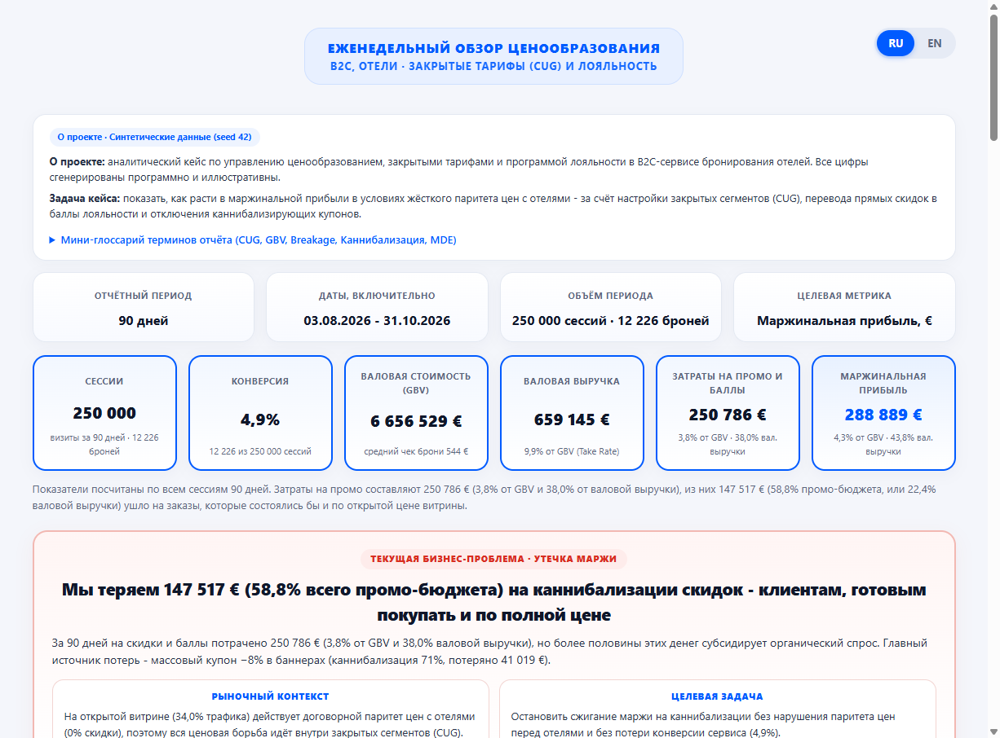

# Ценообразование в B2C OTA - Закрытые тарифы (CUG), программа лояльности и оптимизация промо

> **Дисклеймер:** Синтетические данные (seed = 42), все цифры иллюстративны и созданы для демонстрации методологии ценообразования без использования закрытых данных реальных компаний.

[**English version → README.md**](README.md) · [**Открыть интерактивный отчёт и калькулятор чувствительности (RU / EN) →**](https://kochetova-daryaa.github.io/ota-cug-loyalty-pricing/)

Комплексный проект по управлению ценообразованием, закрытыми тарифами (CUG) и программой лояльности в B2C-сервисе онлайн-бронирования отелей (OTA). Внутренний Python-пакет назван `keystone` (замковый камень в арке) - он символизирует баланс между поддержанием коммерческого паритета цен на открытой витрине отелей и ценовой конкуренцией внутри закрытых пользовательских сегментов.

В отельном бизнесе коммерческие условия работы с отелями и правила ранжирования в метапоиске требуют удерживать паритет цен на открытой витрине (`public_parity`). Поэтому реальное управление ценой, конверсией, долей рынка и маржинальностью происходит внутри **закрытых пользовательских сегментов (CUG - Closed User Groups)**: клубного тарифа после авторизации на сайте (`member_web`), закрытого тарифа в мобильном приложении (`app_only`), триггера брошенной корзины (`cart_recovery`) и промокодов (`blanket_promo`).

Проект проводит аудит **каннибализации промо-бюджета** на синтетической выборке из 250 000 поисковых сессий за 90 дней (03.08.2026 - 31.10.2026) и формирует еженедельный пакет ценовых решений с использованием **Python (`scipy`, `pandas`, `numpy`), SQL с оконными функциями, классического 50/50 A/B-теста с интерактивным калькулятором резерва под баллы, финансовой модели в Excel, мер DAX / Tableau LOD и двуязычного (RU / EN) управленческого отчёта**.

[](https://kochetova-daryaa.github.io/ota-cug-loyalty-pricing/)

---

## 1. Ключевые цифры и полная сверка P&L (база 90 дней)

- **Фактическая база за 90 дней (250 000 сессий · 12 226 броней · 4,9% конверсия):**
  - **Валовая стоимость бронирований (GBV):** **6 656 529 €** (средний чек брони 544 €)
  - **Валовая выручка (Gross Revenue, удержанная комиссия после отмен):** **659 145 €** (**9,9% от GBV - Take Rate**). *Почему 9,9% при наценке 12% к нетто отеля?* Наценка 12% поверх нетто-тарифа отеля составляет `12 / 112 = 10,71%` от цены витрины (GBV) до отмен; после вычета ~10% отмен (при отмене удерживается 25% сбора) реализованная валовая выручка равна 9,9% от GBV.
  - **Затраты на промо и баллы:** **250 786 €** (3,8% от GBV · 38,0% от валовой выручки)
  - **Потери на каннибализации промо:** **147 501 € (58,8% всего промо-бюджета)** ушло клиентам, готовым бронировать и по полной цене открытой витрины
  - **Платёжный эквайринг (1,4% от удержанного GBV) и привлечение трафика:** **86 129 €** эквайринг + **33 342 €** затраты на сессии = **119 470 €**
  - **Маржинальная прибыль (целевой KPI):** **288 889 €** (4,3% от GBV · 43,8% от валовой выручки), полная формула сверки:
    `659 145 € (Валовая выручка) − 250 786 € (Промо и баллы) − 86 129 € (Эквайринг 1,4%) − 33 342 € (Трафик) = 288 889 €`
- **Эффект предлагаемого пакета решений (на тех же 250 000 сессиях):**
  - **Прирост маржинальной прибыли:** **+72 640 € (+25,1% к базе)** - рост с 288 889 € до 361 529 € (маржинальность растёт с 4,3% до 5,4% от GBV)
  - **Экономия затрат на промо:** **−70 583 € (−28,1% к текущему промо-бюджету)**
  - **Конверсия и паритет:** сохранение конверсии **+0,0 п.п. (+0,3% отн.)** и **100% соблюдение паритета цен на открытой витрине** (120 из 120 правил в выгрузке `output/fence_rules_shelf.csv`)

### Три рычага, формирующие 100% результата

| Рычаг решения | Доля эффекта | Δ маржинальной прибыли | Δ затрат на промо | Суть изменения |
|---|---:|---:|---:|---|
| **1. Отключение неэффективного купона** (`blanket_promo`) | **52,9%** | +38 402 € (база 3 016 € → 41 419 €) | −41 661 € (−71,4%) | Закрываем публичный купон −8% в баннерах (71% каннибализации) и переводим в 5% приветственных баллов (резерв 2,4% от GBV) |
| **2. Перевод скидок в баллы** (`member_web` + `cart_recovery`) | **28,6%** | +20 792 € | −21 999 € | Дораскатываем 9% баллами (резерв 4,3%) на вторые 50% клубного веба (+11 457 €) и вводим порог чека >= 180 € в корзине с 7,5% баллами (+9 335 €) |
| **3. Таргетинг по глубине в Приложении** (`app_only`) | **18,5%** | +13 445 € (+19,4%) | −6 923 € (−8,3%) | Вместо плоской скидки −5% ставим сетку по глубине заезда: −3% на неэластичном окне 0–3 дня (каннибализация 69%) и −6% на эластичном окне 8+ дней (каннибализация 39%, +0,3 п.п. к конверсии) |

---

## 2. Классический A/B-тест 50/50 и модель резервирования (`1. Клубный тариф сайта`: −6% деньгами против 9% баллами)

- **Дизайн:** 60 337 сессий авторизованных пользователей веба за 90 дней, сплит 50/50:
  - **Группа A (Контроль):** прямая скидка −6,0% деньгами (29 904 сессии, 1 362 брони, маржинальная прибыль ветки **19 313 €**).
  - **Группа B (Тест):** кешбэк 9,0% баллами на следующую поездку (30 433 сессии, 1 484 брони, ожидаемая маржинальная прибыль ветки **33 880 €** при ставке резерва 4,3% от GBV).
- **Что измерено напрямую в эксперименте, а что рассчитано по модели резерва:**
  - **Измерено напрямую в A/B-тесте (Конверсия и Отмены):** конверсия составила 4,6% в Группе A против 4,9% в Группе B (+0,3 п.п., +7,1% к контролю, z-тест долей `p = 0,062`). Это не доказывает рост конверсии, но подтверждает **отсутствие просадки конверсии за пределы защитного порога non-inferiority (−2,5% отн.)** при пороге чувствительности `MDE = 0,5 п.п.` (мощность 80%). Доля отмен не изменилась (8,8% против 8,9%).
  - **Рассчитано по когортной модели резервирования (Маржинальная прибыль):** поскольку срок жизни баллов составляет 12 месяцев, фактическое списание баллов не завершается внутри 90-дневного окна теста. Себестоимость 9% баллов начисляется по ставке резерва (4,32% от GBV против 6,00% деньгами), что даёт 0,646 € в Группе A против **1,113 €** в Группе B (**+0,467 € на сессию, +72,4% к контролю**, t-тест Уэлча, 95% ДИ 0,381 € … 0,553 €, `p < 0,001`). В HTML-отчёте и Excel-книге встроен интерактивный калькулятор чувствительности к доле `breakage` и зачёту экономии на рекламе.
- **Сверка базы сегмента с матрицей решений (Раздел 1):**
  - В отчётные 90 дней внутри `member_web` уже шёл сплит 50/50: фактическая база маржинальной прибыли сегмента 53 193 € складывается из **19 313 €** (Группа A, −6% деньгами) и **33 880 €** (Группа B, 9% баллами), а средняя себестоимость промо по сегменту составила 5,2% от GBV.
  - Поскольку разница конверсии в A/B-тесте (+0,3 п.п., +7,1% отн.) имеет `p = 0,062 > 0,05`, в матрицу раскатки Группы B на оставшиеся 50% сегмента заложено **консервативное изменение конверсии 0,0%**, что даёт ровно **+11 457 €** прироста маржинальной прибыли за счёт снижения затрат на промо на **−11 457 €**.

---

## 3. Допущения модели и как это измеряется на реальных данных (`Assumptions`)

Поскольку датасет синтетический (`keystone/generate.py`), скрытые состояния покупателя известны генератору напрямую. В реальном продакшене OTA эти параметры оцениваются и калибруются следующим образом:

1. **Как на реальных данных измеряется «купил бы и без скидки» (Каннибализация промо):**
   - *В генераторе (`keystone/generate.py`):* для каждой сессии раздельно моделируется базовая органическая вероятность покупки (`cvr_organic`) и прирост от промо (`cvr_uplift`). В мобильном приложении (`app_only`) на коротком окне 0–3 дня органическая готовность купить высока (**каннибализация 69%**), а на длинном окне 8+ дней клиент сравнивает несколько сервисов (**каннибализация 39%**, ценовая эластичность выше). Именно поэтому перенос глубины скидки с короткого окна (−3%) на длинное окно (−6%) повышает конверсию сегмента (+0,3 п.п.) даже при снижении средней скидки с 5,0% до 4,4%.
   - *В реальном бизнесе:* у конкретного заказа нельзя напрямую увидеть контрфактуал, поэтому каннибализация измеряется через **постоянную контрольную группу удержания (`Holdout 5–10%`)**, которой не показывается баннерный купон или промо-триггер. Отношение конверсии в контроле без промо к конверсии в группе с промо (`CVR_holdout / CVR_promo`) даёт фактическую долю каннибализации по каждому сегменту и окну глубины бронирования.
2. **Допущения по 36% Breakage баллов и 25% экономии на повторной рекламе:**
   - *Формула расчётной ставки резерва под баллы (`keystone/economics.py`):*
     ```text
     c_eff = r_nominal * (1 - breakage) * (1 - ad_saving)
           = 0,09 * (1 - 0,36) * (1 - 0,25) = 0,0432 (4,32% от GBV)
     ```
   - *Калибровка и учётная политика:* Значения 36% неиспользованных баллов (`breakage`) и 25% экономии на повторном привлечении - это **модельные допущения синтетического стенда**; в продакшене они калибруются на собственных исторических когортах (доля сгорания баллов по сроку жизни 12 мес. и атрибуция повторных заказов в прямые каналы). Если финансовый учёт компании не засчитывает будущую экономию маркетингового CAC в уменьшение резерва под баллы (`ad_saving = 0%`), то строгая учётная себестоимость 9,0% баллов равна `0,09 * (1 - 0,36) = 5,76%` от GBV - что всё равно ниже прямой скидки 6,0% деньгами (точка безубыточности по `breakage` без зачёта рекламы равна 33,3%, а с зачётом рекламы - 11,1%, если сравнивать только ставку затрат на промо; по маржинальной прибыли на сессию, с учётом дополнительных броней Группы B, точка безубыточности без зачёта рекламы около 31% - это видно на ползунках чувствительности в дашборде).
3. **Почему валюта расчётов - евро (EUR):**
   - Контракты с зарубежными отелями и оптовыми поставщиками (Европа, Средиземноморье, Турция) номинированы в евро; фиксация управленческого учёта в EUR очищает 90-дневную оценку эластичности и A/B-теста от курсовой волатильности.

---

## 4. Состав репозитория

- **`index.html` / `output/pricing_cockpit.html`** - автономный двуязычный (RU / EN) управленческий отчёт с интерактивным симулятором чувствительности резерва под баллы.
- **`output/keystone_pricing_cockpit.xlsx`** - Excel-книга с живыми формулами: лист `Promo_Calculator` (калькулятор «Скидка деньгами против Кешбэка баллами»), `Scorecard`, `AB_Test`, `Daily` (умная таблица с фильтрами), `Weekly`.
- **`sql/01_indexes.sql` … `06_hotel_rank.sql`** - 5 аналитических витрин в SQLite с `JOIN`, агрегациями и оконными функциями (`AVG/SUM OVER`, `LAG 7`, `RANK`).
- **`bi/`** - меры DAX для Power BI (`bi/powerbi/measures.dax`) и вычисляемые поля LOD для Tableau (`bi/tableau/calculated_fields.md`).
- **`reports/monday_brief.ru.md` и `monday_brief.en.md`** - автоматические понедельничные записки на русском и английском языках.
- **`keystone/` и `tests/`** - исходный код на Python и автотесты `pytest`.

---

## 5. Быстрый запуск

```bash
# Установка зависимостей
pip install -r requirements.txt

# macOS / Linux / активированное виртуальное окружение
python -m pytest -q
python -m keystone run --sessions 250000 --seed 42

# Windows (через стандартный лаунчер py)
py -3 -m pytest -q
py -3 -m keystone run --sessions 250000 --seed 42
```
